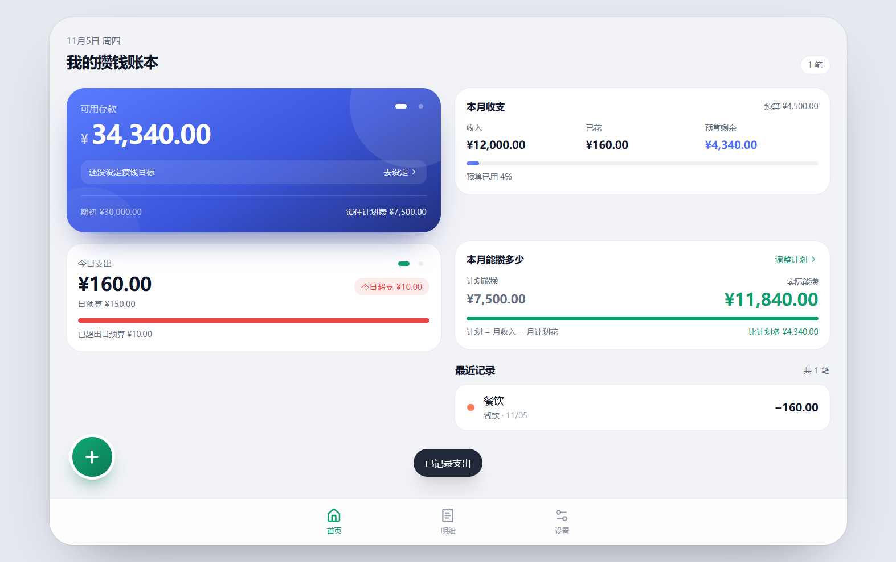
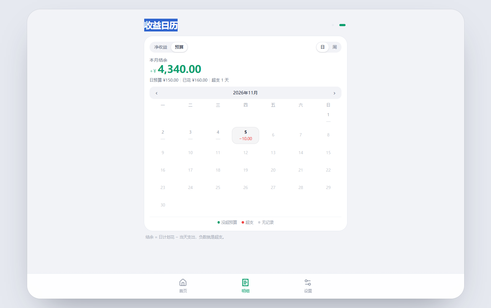
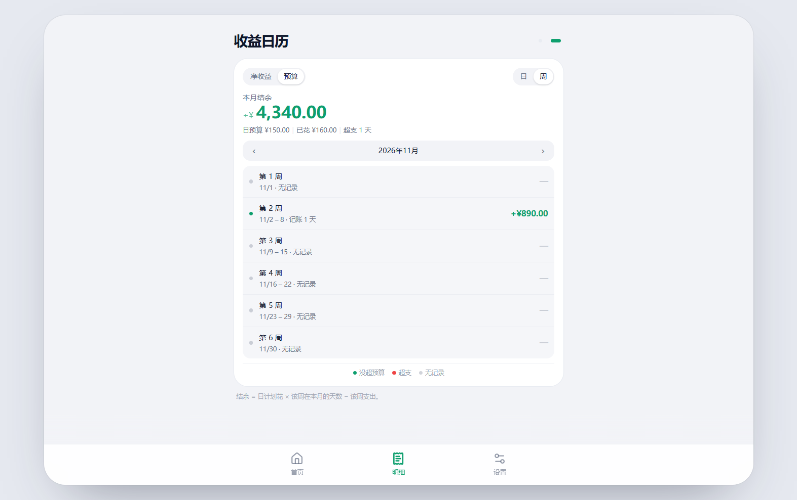

# 鲸鱼记账 · Whale Ledger

一个只做「攒钱」一件事的记账工具：先设收入和攒钱目标，再手动记每一笔，实时算出今天盈亏、本月能攒多少。

纯前端，数据只存在本机；配了一个不依赖 Gradle 的 150 行 Android 壳，可以打包成 APK 装到手机上离线用。



## 功能

- **计划**：月收入、期初存款、每月计划攒 / 计划花（月、周、日三档联动，改一个其余自动算好）
- **记一笔**：金额、收支、分类、备注、日期；预置分类 + 自定义分类
- **首页双卡**：可用存款 / 累计存款，左右滑动切换，各自带攒钱目标进度
- **今日 · 本周**：两张滑动卡片，显示支出、预算使用比例和超支提示
- **明细**：账单按天分组，删除前二次确认
- **收益日历**：两种口径（净收益 / 相对日预算）× 两种范围（日 / 周），整月一屏
- **设备同步**：手机和平板在同一 Wi-Fi 下扫码配对，WebRTC 直连，数据不经过服务器
- **PWA**：可装到桌面、离线可用（Service Worker 仅在生产构建注册）

| 收益日历 · 日 | 收益日历 · 周 |
|---|---|
|  |  |

## 算钱的口径

这些东西容易记混，先说清楚：

| 概念 | 公式 |
|---|---|
| 累计存款 | 期初存款 + Σ(各月收入 − 各月支出)，**本月始终计入**（没记账也算进月收入） |
| 可用存款 | 累计存款 − 本月计划攒 |
| 攒钱目标进度 | 各自的数字 ÷ 目标 |
| 今日盈亏 | 今日收入 − 今日支出 |
| 今日盈余/超支 | 日计划花 − 今日支出 |
| 本周盈余/超支 | 周计划花 − 本周（周一起）支出 |

两者的关系是 `可用 + 本月计划攒 = 累计`：支出先花「计划花」，花超了才动「计划攒」，所以可用会随支出往下走。

## 开发

```bash
npm install
npm run dev      # http://127.0.0.1:5173
npm run build    # 生产构建
```

技术栈：React 19 + TypeScript + Vite + Tailwind CSS 4，状态全部在 localStorage，没有后端。

## 打包 APK

`android/` 是一个最小 WebView 壳，**不用 Gradle**：网页产物放进 `android/assets/www`，App 启动时在 `127.0.0.1:47121` 起一个只服务本地资源的小 HTTP 服务，WebView 按普通网页加载。

需要准备：

- JDK 17+（`JAVA_HOME`）
- Android SDK：`build-tools`（aapt2 / d8 / zipalign / apksigner）和 `platform` 的 `android.jar`（`ANDROID_SDK_ROOT`），不装 Android Studio 也行，官方 zip 直接解压即可
- Python 3（打包时用来修正 assets 路径）

```bash
npm run build -- --base=./ --outDir=dist-apk
# 把 dist-apk 的内容复制到 android/assets/www
export WHALE_KEYSTORE=/path/to/release.jks
export WHALE_KEY_PASS=你的口令
powershell -ExecutionPolicy Bypass -File android/pack.ps1
```

签名口令只从环境变量 `WHALE_KEY_PASS` 读，**不会**写进仓库；首次构建可以自己生成一个：

```bash
keytool -genkeypair -v -keystore release.jks -alias whale \
  -keyalg RSA -keysize 2048 -validity 10000
```

产物在 `android/build/whale-ledger-<版本>.apk`。版本号取自 `AndroidManifest.xml`。

> 打包时有几个坑已经踩过了，脚本里都处理了：Windows 上的 `aapt2` 会把 assets 路径写成反斜杠（`repack.py` 会修正）、`resources.arsc` 必须不压缩（否则 Android 11+ 拒绝安装）、老的 `d8` 在新 JDK 上会崩（脚本会自动挑版本最高的 build-tools）。

## 目录结构

```
android/            Android WebView 壳 + 打包脚本
  java/.../MainActivity.java
  res/              图标、主题、应用名
  pack.ps1          一键打包（aapt2 -> javac -> d8 -> repack -> zipalign -> 签名）
  repack.py         修正 assets 分隔符 + 补 classes.dex
src/
  core/             类型、计算、时间、计划联动、分类、WebRTC 同步、持久化
  ui/               卡片、弹层、日历、进度条等组件
  screens/          首页 / 明细 / 设置
public/             PWA 清单、Service Worker、图标
docs/screenshots/   README 用的截图
```

## 已知限制

- 数据存在浏览器 / WebView 的 localStorage 里，**卸载即丢**，换设备不会自动迁移。
- 设备同步要求两台设备在同一个局域网，跨网络不行（纯 P2P，没有服务器中转）。
- 历史月份没有保存当时的计划快照，所以改「每月收入」会连带改变历史月份的累计存款。

## License

[MIT](LICENSE)